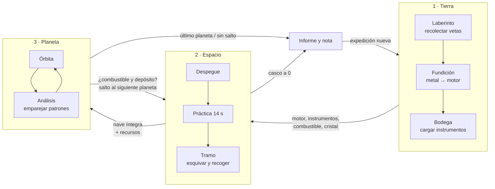
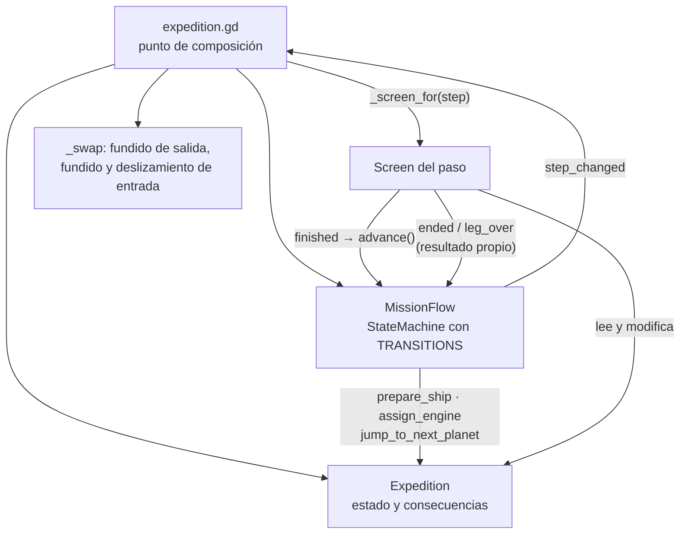
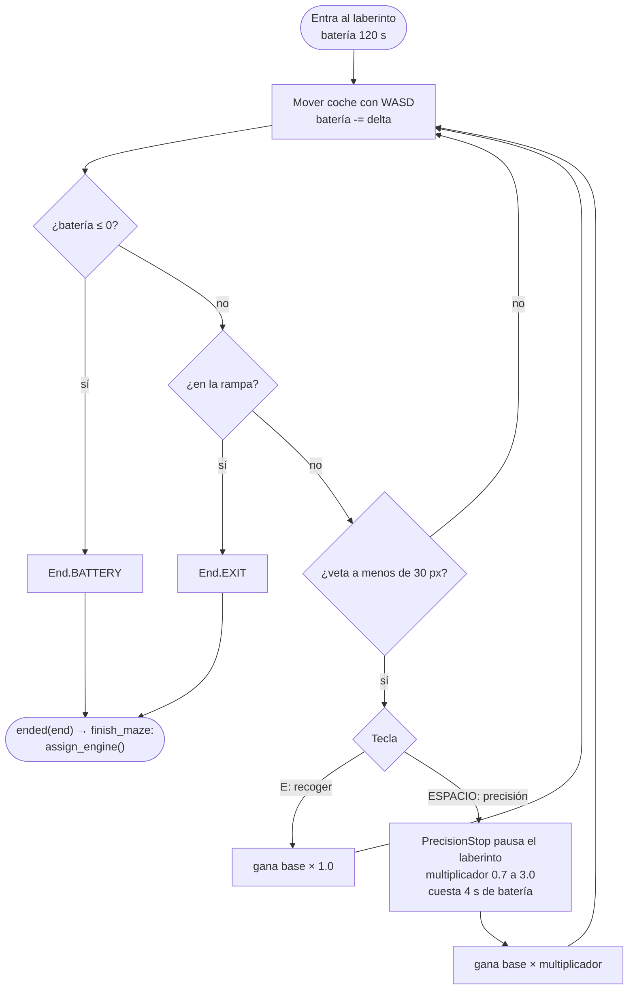
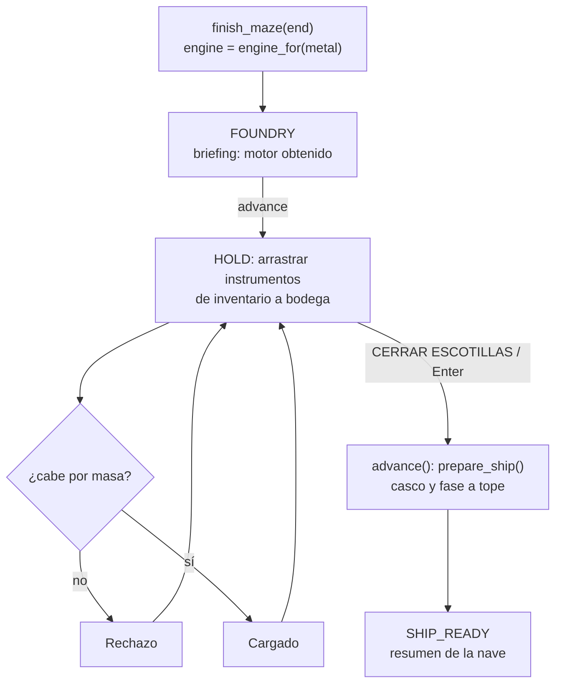
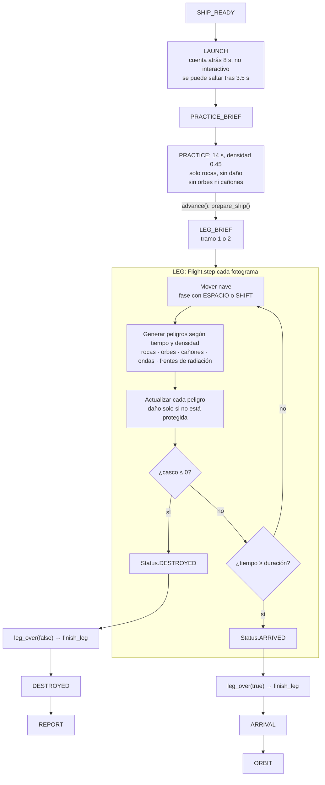
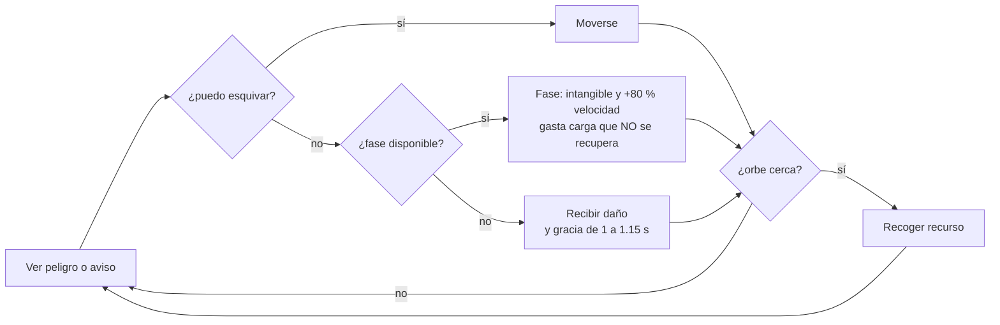
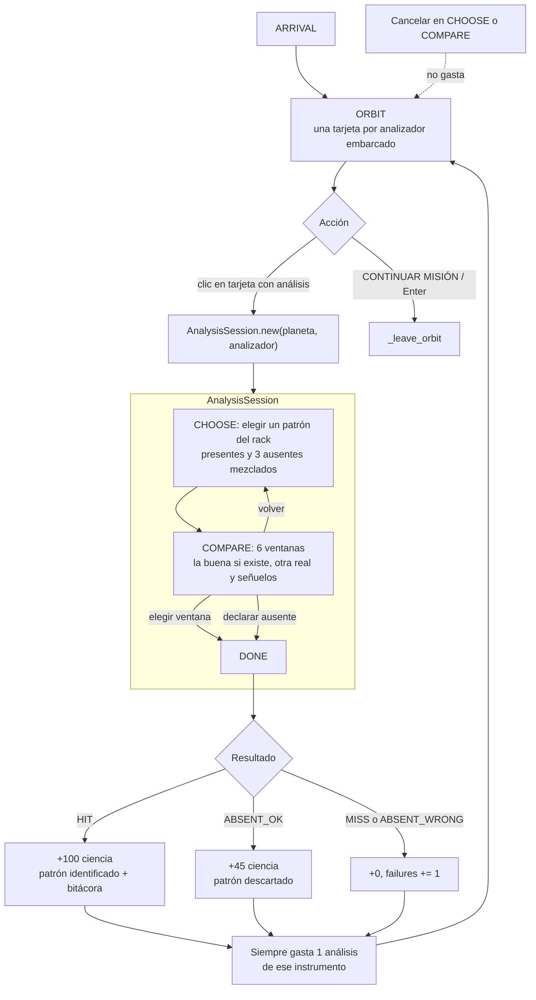
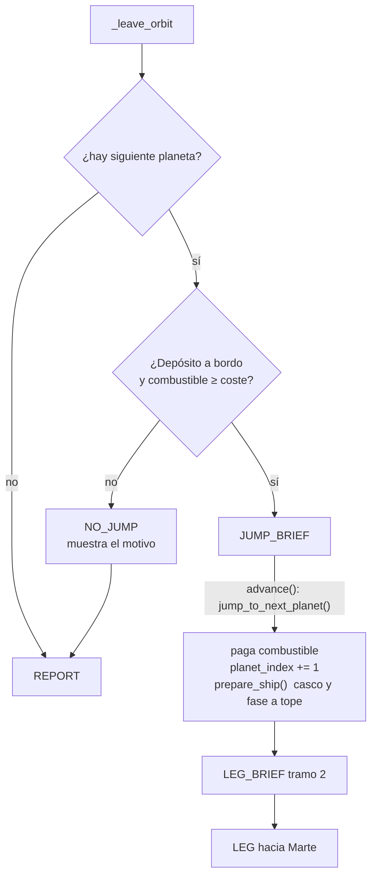
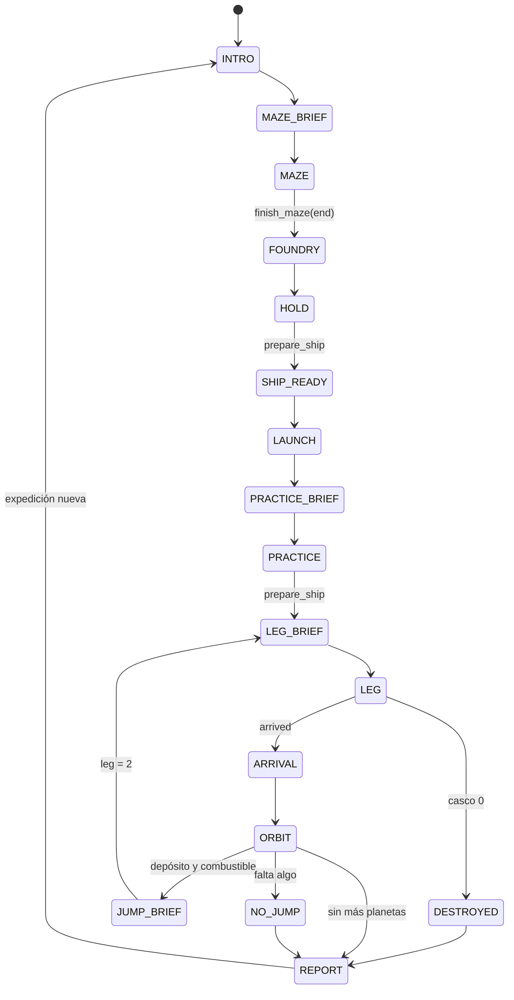
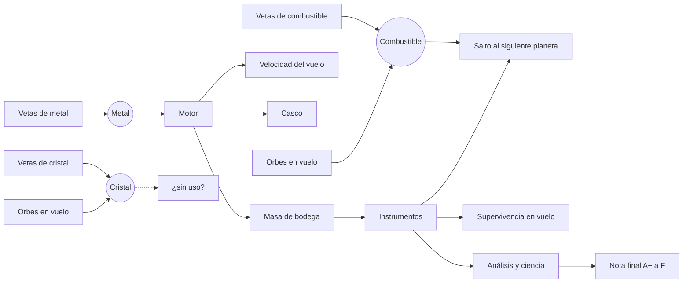

# Game loop — Nivel Expedición

Análisis del bucle de juego del nivel `app/levels/expedition.gd`. El nivel no tiene reglas: es el punto de composición que crea `Catalog`, `Expedition`, `MissionFlow` y las pantallas. El bucle real vive en `game/expedition/` (`MissionFlow` decide el paso; cada `Screen` es un bucle propio).

Índice: [0 Visión general](#0-visión-general) · [1 Exploración terrestre](#1-exploración-terrestre-laberinto--fundición--bodega) · [2 Operaciones espaciales](#2-operaciones-espaciales-despegue--vuelo) · [3 Exploración planetaria](#3-exploración-planetaria-órbita--análisis) · [4 Bucle de campaña](#4-bucle-de-campaña-y-economía) · [5 Observaciones](#5-observaciones-para-corregir-o-mejorar)

---

## 0. Visión general

Tres fases jugables unidas por una cadena de consecuencias. Lo que se hace en una fase fija las condiciones de la siguiente:

```
metal (laberinto) → motor → masa de bodega → instrumentos → qué se sobrevive en vuelo y qué se analiza en órbita
```



### Quién manda en el flujo



Cada paso termina de una de dos formas: **`advance()`** (pantallas que se leen o cierran con un botón) o **resultado propio** (`finish_maze(end)` y `finish_leg(arrived)`, que traen datos). `_uses_own_result` en el nivel decide cuál conectar.

---

## 1. Exploración terrestre (laberinto → fundición → bodega)

**Objetivo del jugador:** sacar el máximo metal posible en 120 s para tener un buen motor, y guardar combustible y cristal para después.

### 1.1 Laberinto (`MazeScreen` / `MazeRun`)



**Decisión central (riesgo/recompensa):** cada veta se recoge «a bulto» o con precisión. La precisión rinde hasta ×3 pero cuesta 4 s de batería, y cada uso acelera el cursor (`BASE_SPEED + 0.42 × usos`). Salir pronto por la rampa conserva batería pero se deja de recolectar: no hay recompensa por sobrar tiempo.

| Veta | Base | Cantidad |
|---|---|---|
| Chatarra de acero (frente a la entrada) | 34 metal | 1 |
| Metal | 20–30 | 6 |
| Cristal | 16–22 | 3 |
| Combustible | 20 y 24 | 2 |

Con `E` solo, el metal total es 184 (motor RD-3: umbral 150). El RD-4 (240) exige usar precisión.

### 1.2 Fundición y bodega



| Motor | Metal | Masa máx. | Empuje | Casco |
|---|---|---|---|---|
| RD-1 | 0 | 110 | 1.00 | 100 |
| RD-2 | 70 | 180 | 1.15 | 115 |
| RD-3 | 150 | 265 | 1.32 | 130 |
| RD-4 | 240 | 355 | 1.50 | 150 |

Los instrumentos se reparten en tres grupos (más los analizadores de `catalog.analyzers`, que también pesan) y **no caben todos**:

| Grupo | Instrumentos (masa) | Efecto |
|---|---|---|
| Analizador | los de `catalog.analyzers` | permiten medir en órbita |
| Apoyo | Taladro 40, Filtro 12, Computadora 14, Antena 20 | +3 análisis por analizador, descarta 2 señuelos, marca picos, informe completo |
| Nave | Blindaje 45, Casco 28, Celdas 22, Regulador 16, Depósito 30, Bodega 25, Imán 19 | -50 % radiación, +35 casco, +60 fase, fase 34→24/s, **permite saltar**, ×2 recogida, atrae orbes |

**Es la decisión estratégica del juego**: ciencia (analizadores) contra supervivencia (nave) contra alcance (depósito para ir al 2.º planeta).

---

## 2. Operaciones espaciales (despegue → vuelo)



### Bucle interno del tramo

Cada fotograma el jugador decide **dónde estar y cuándo ser intangible**:



| Peligro | Daño | Aviso | Contramedida |
|---|---|---|---|
| Roca | 11 | ninguno (se ve) | esquivar o fase |
| Onda de choque | 15 | `WAVE_WARNING` | esquivar o fase |
| Cañón láser | 26 | `LASER_WARNING` (apunta a la nave) | salir de la línea o fase |
| Frente de radiación | 17 × radiación por segundo, ×0.5 con blindaje | `FRONT_WARNING` | salir de la zona o fase |

Dificultad: crece con el progreso (`p`) dentro del tramo y con la `densidad` y `radiación` del planeta (Luna 68 s, 1.0 y 1.0; Marte 86 s, 1.3 y 1.35).

**Recursos en vuelo:** los orbes dan cristal (×2 de probabilidad), metal o combustible, de 4 a 9 unidades; la bodega de muestras los duplica y el imán los atrae. Es la única fuente de combustible fuera del laberinto.

---

## 3. Exploración planetaria (órbita → análisis)



**Decisión central:** cada analizador trae `4 (+3 con taladro)` análisis **por planeta** y el rack tiene hasta `presentes + 3 ausentes` candidatos. No alcanza para todo: hay que elegir qué patrón probar y cuándo declarar «ausente». El Filtro descarta 2 señuelos, la Computadora marca la posición de los picos y la Antena da el informe completo.

### Salida de la órbita



Hoy el salto cuesta 55 de combustible (Marte) y exige el **Depósito auxiliar** (30 de masa).

---

## 4. Bucle de campaña y economía

Máquina de estados completa (`MissionFlow.TRANSITIONS`):



### Flujo de recursos



La nota (`AnalysisLedger.grade`) es la fracción de hallazgos sobre lo que **los analizadores embarcados** podrían medir: A+ ≥ 85 %, A ≥ 60 %, B ≥ 40 %, C ≥ 20 %, D algo, F nada.

---

## 5. Observaciones para corregir o mejorar

Hallazgos de leer el código. Cada uno es candidato a `D#` de un plan si se decide actuar (AGENTS.md §4 paso 0). Ordenados de mayor a menor impacto en el bucle.

### Bucle general

- [ ] **O1. El cristal no se gasta en ninguna parte.** Se recoge en el laberinto (3 vetas) y en vuelo (la mitad de los orbes), se muestra en el HUD, pero ninguna regla lo consume (`grep Res.CRYSTAL` solo da datos y dibujo). Ocupa dos de los cuatro destinos de orbe sin dar decisión alguna. Opciones: darle un sumidero (reparar casco en órbita, recargar fase, comprar análisis extra) o quitarlo.
- [ ] **O2. La carga es ciega y definitiva.** La bodega se decide antes de conocer los peligros y no se vuelve a abrir, ni siquiera tras llegar al 1.er planeta. Con una sola decisión, el 2.º tramo hereda lo cargado para la Luna. Opción: reabrir `HOLD` en `JUMP_BRIEF` (solo con la masa que quede).
- [ ] **O3. Perder el tramo termina la campaña sin segunda oportunidad.** `DESTROYED → REPORT → INTRO` descarta el progreso científico, incluso con la Luna ya analizada. Opciones: informe parcial con nota (ya existe), punto de guardado tras la órbita, o un respawn con penalización.
- [ ] **O4. No hay rejugabilidad con memoria.** Todo se reinicia (`start()`), y el laberinto, los peligros y las ventanas usan semilla fija (`MAZE_SEED`, `Flight.SEED`, `AnalysisSession.SEED`). Segunda partida = misma partida. Opción: semilla por expedición, pasada a `Catalog`/`Flight`/`AnalysisSession`.

### Exploración terrestre

- [ ] **O5. Sin recompensa por llegar a la rampa con batería.** `End.EXIT` y `End.BATTERY` llevan al mismo sitio; salir pronto solo pierde vetas. Opción: bonus por batería restante o hacer que la rampa sea una decisión de «ya tengo bastante».
- [ ] **O6. El umbral del RD-4 solo se alcanza con precisión.** Metal base total 184 frente a 240 del RD-4: el techo exige ≥ 1 extracción buena. Es coherente, pero conviene confirmarlo como diseño y no como accidente.
- [ ] **O7. El motor se fija solo.** `assign_engine()` elige el mejor motor posible sin decisión del jugador. Con más metal de sobra no hay elección (por ejemplo, gastar metal en otra cosa).

### Operaciones espaciales

- [ ] **O8. La fase no se recupera en el tramo.** Con 120 de carga y 34/s caben ~3.5 s por tramo; con celdas y regulador, 7.5 s. Es poco para una mecánica central. Revisar si la escasez es buscada o si hace que el jugador no la use hasta el final.
- [ ] **O9. La práctica no ensaya lo difícil.** Solo hay rocas: sin cañones, ondas, radiación ni orbes. Quien llegue al tramo real descubre allí tres mecánicas nuevas con daño real. Opción: añadir un cañón y una onda de aviso, sin daño, en la práctica.
- [ ] **O10. Despegue pasivo de 8 s.** `LAUNCH` no interactúa (se puede saltar a partir de 3.5 s). Es transición, pero ocupa un paso del bucle sin decisión. Valorar convertirlo en transición del propio `Screen` sin `Step`.
- [ ] **O11. La destrucción tiene prioridad sobre la llegada.** `Flight.step` comprueba `is_destroyed()` antes que `t >= duration`; el último golpe del último fotograma cuenta como derrota. Los peligros dejan de generarse 3 s antes (`HAZARD_CUTOFF`), así que casi no ocurre, pero `ROCK_CUTOFF` es 1.5 s y las rocas ya lanzadas siguen vivas.
- [ ] **O12. `ARRIVED` se detecta con el tiempo previo (`t`).** Llega un fotograma después de cumplirse la duración. Es inocuo; solo está documentado aquí.

### Exploración planetaria

- [ ] **O13. El jugador puede salir de la órbita sin gastar nada.** `CONTINUAR MISIÓN` no avisa de que quedan análisis; el coste de una decisión descuidada es solo perder nota. Opción: confirmar si quedan análisis y hallazgos posibles.
- [ ] **O14. La semilla de ventanas no depende del patrón elegido ni de la partida.** Sale de `analyzer.id`, `planet.id.length()` y `spent`: en la misma partida, mismo planeta, analizador y gasto dan siempre el mismo reparto. Además `planet.id.length()` hace que dos planetas con ids de igual longitud compartan semilla. Opción: hash del id completo y semilla de expedición (O4).
- [ ] **O15. Cancelar no cuesta pero repite.** `AnalysisSession.back()`/cancelar no gasta el análisis y reconstruye las ventanas con la misma semilla (el gasto no cambia), así que el jugador puede **inspeccionar las seis ventanas de un patrón, cancelar y volver sin coste**. Es un exploit de información: revisar si es deseado.
- [ ] **O16. `ABSENT_WRONG` y `MISS` penalizan igual.** Declarar ausente algo presente y elegir una ventana equivocada son errores distintos con el mismo costo (+1 `failures`, un análisis perdido). `failures` además no se usa más que en el informe.

### Técnicas (de `MissionFlow` y del nivel)

- [ ] **O17. `JUMP_BRIEF` puede quedarse sin respuesta.** En `advance()`, si `jump_to_next_planet()` devuelve `false`, no se hace nada: la pantalla no avanza ni avisa. Es inalcanzable por `_leave_orbit` (solo entra con `can_travel()`), pero la defensa es silenciosa. Cambiar por `push_error` o ir a `NO_JUMP`.
- [ ] **O18. `leg` se pierde con el guardado.** `MissionFlow.leg`, `maze_end` y `loss_reason` no están en el `Expedition` y por tanto no hay `snapshot()` posible del flujo (AGENTS.md regla 9). Si se añade guardado entre fases (O3), hay que decidir quién lo posee.

### Qué mantener

- La cadena metal → motor → masa → instrumentos → consecuencias es clara y ya está desacoplada en `Expedition`.
- `MissionFlow.TRANSITIONS` declara el flujo en un solo sitio, con una transición ilegal como error visible (regla 8).
- El patrón «resultado propio» (`finish_maze`, `finish_leg`) frente a `advance()` mantiene datos fuera de los botones.
- El análisis tiene decisiones reales (qué patrón, cuándo declarar ausente) con consecuencias medibles.

---

## Fuentes

`app/levels/expedition.gd`, `game/expedition/mission_flow.gd`, `expedition.gd`, `maze/maze_run.gd`, `flight/flight.gd`, `analysis/analysis_session.gd`, `analysis/analysis_ledger.gd`, `data/catalog.gd`, `data/mission_data.gd` y las vistas `maze_screen`, `hold_screen`, `launch_screen`, `flight_screen`, `orbit_screen`.

No se ejecutó el juego: los números salen de las constantes del código. O15 (cancelar y repetir) se deduce de leer `OrbitScreen` y `AnalysisSession`; no se probó en ejecución. El conteo de combustible en orbes (1 de 4 destinos) sale de `Flight.ORB_RESOURCES`.
